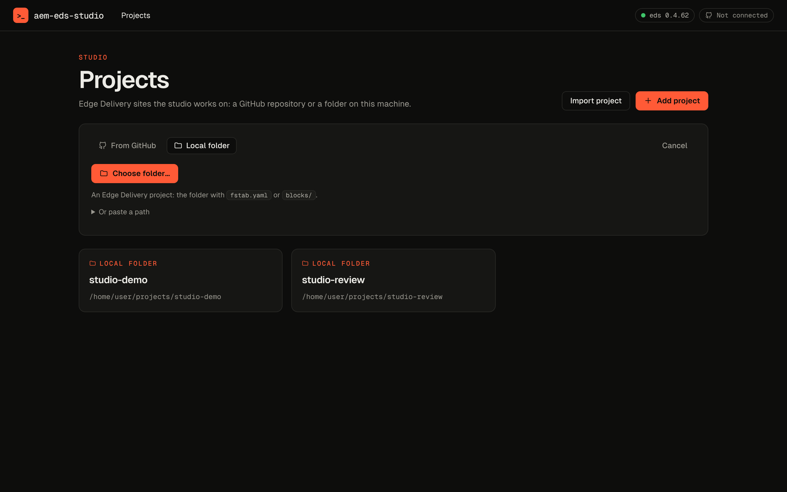
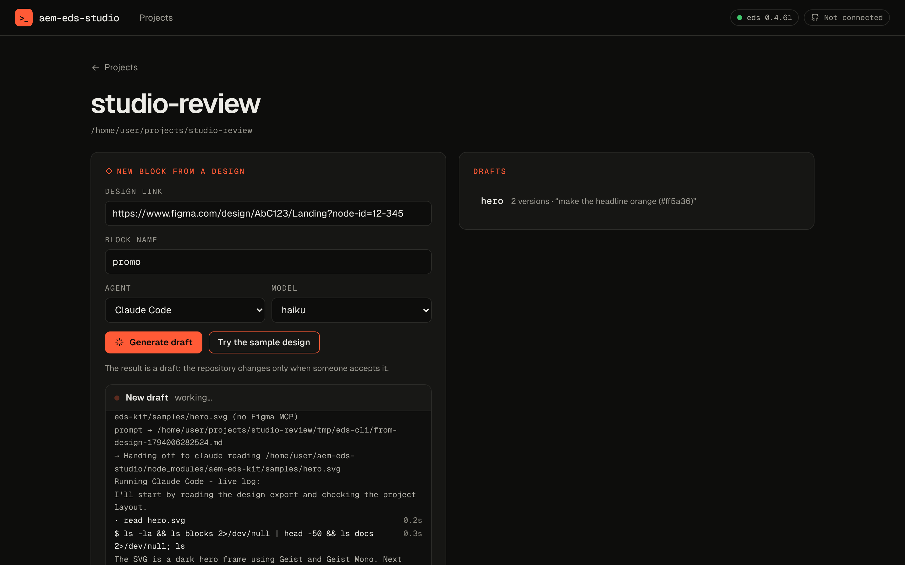
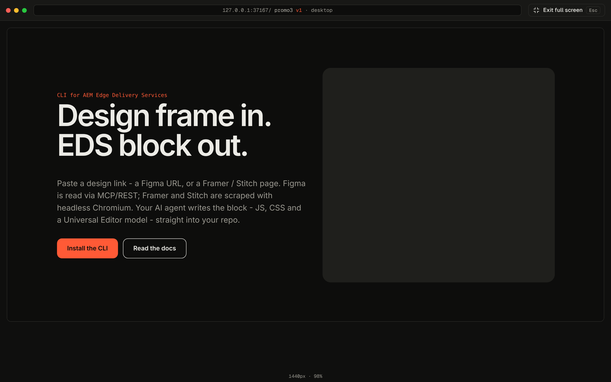

<p align="center">
  
</p>

<h1 align="center">AEM EDS Studio</h1>

<p align="center">
  Turn a design into an AEM Edge Delivery block, review it in rounds, accept it into the repo.<br>
  For developers, managers and clients. Desktop app for macOS and Windows.
</p>

<p align="center">
  <a href="https://github.com/piotrgodycki/aem-eds-studio/releases/latest/download/AEM-EDS-Studio-mac-arm64.dmg"></a>
  <a href="https://github.com/piotrgodycki/aem-eds-studio/releases/latest/download/AEM-EDS-Studio-mac-x64.dmg"></a>
  <a href="https://github.com/piotrgodycki/aem-eds-studio/releases/latest/download/AEM-EDS-Studio-win-x64.exe"></a>
</p>

<p align="center">
  <a href="https://github.com/piotrgodycki/aem-eds-studio/releases"></a>
  <a href="https://github.com/piotrgodycki/aem-eds-studio/actions/workflows/desktop.yml"></a>
  <a href="https://www.npmjs.com/package/aem-eds-kit"></a>
</p>


## How it works

Nothing reaches the repository until someone accepts it.

| | |
|---|---|
| **1. Add a project**<br>A GitHub repository (cloned for you) or an Edge Delivery folder on your disk, chosen in the system's folder picker. |  |
| **2. New block from a design**<br>Paste a Figma, Framer, Stitch or any page link, name the block, pick the agent and model. The log shows each step and what it cost. |  |
| **3. Review**<br>The preview fills the window, with tabs for the versions. *Request changes* sends a comment, and the agent makes the next version. |  |
| **4. Full screen, then accept**<br>Check it full screen or in your browser. *Accept* commits only `blocks/<name>/` on a branch, with the review rounds in the commit message. *Discard* drops the draft. |  |

## Install

1. Download the installer for your system using the buttons above, or from [Releases](https://github.com/piotrgodycki/aem-eds-studio/releases).
2. **macOS:** open the `.dmg` and drag the app to Applications. **Windows:** run the `.exe`. It installs for the current user.
3. **First launch of an unsigned build:**
   - **macOS:** *System Settings → Privacy & Security → Open Anyway*.
   - **Windows:** *More info → Run anyway*.
4. **Updates come to the app.** It checks for a new release at start and every few hours, downloads it in the background and shows *Restart to update* in the header. On macOS, until the builds are signed, the button downloads the new `.dmg` instead.

**You need**
- An agent: Claude Code, Cursor, Codex, or a local model through Ollama / oMLX.
- `git`, to accept drafts.

**You don't need**
- Node. The app has its own runtime and the [aem-eds-kit](https://www.npmjs.com/package/aem-eds-kit) engine inside.

For GitHub projects, click **Connect GitHub** in the header: the app shows a code, you confirm it on github.com, and the token goes to your system keychain. `gh auth login` and `GITHUB_TOKEN` work too. The token never leaves your machine.

## Who it's for

| Role | Does |
|---|---|
| **Developer** | Everything: projects, generation, review, accept. |
| **Manager** | Reviews drafts, requests changes, accepts. |
| **Client** | Pastes a design link, then requests changes or accepts. |

## Under the hood

- **The engine is the CLI.** Every action runs `eds … --json` from [aem-eds-kit](https://github.com/piotrgodycki/aem-eds-kit) and streams its events. Nothing is re-implemented in the studio.
- **Local and safe.**
  - The server listens on `127.0.0.1` only and refuses other hosts and origins.
  - Commands run without a shell, with validated arguments.
  - Secrets never reach the repository or the window.
- **Docs:** [architecture](docs/architecture.md), [releases and signing](docs/releases.md), [changelog](CHANGELOG.md).

## From source

```bash
git clone https://github.com/piotrgodycki/aem-eds-studio && cd aem-eds-studio
npm install
npm run desktop            # build and open the app
```

| Command | What it does |
|---|---|
| `npm run dev:server` / `npm run dev:web` | API on :4600, UI with hot reload |
| `npm run lint && npm run typecheck && npm test` | checks; tests use a fake `eds`, so no agent runs |
| `npm run dist:mac` / `dist:win` | installers in `release/` |

## Roadmap

- **Done:** projects, drafts with review rounds, accept onto a branch, desktop app with in-app updates.
- **Next:**
  - a pull request after accept;
  - Claude through the API (no local agent needed);
  - MCP servers per project (AEM, Figma);
  - roles;
  - shareable review links.

## License

MIT © Piotr Godycki
