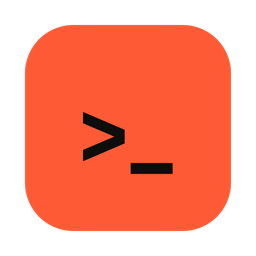
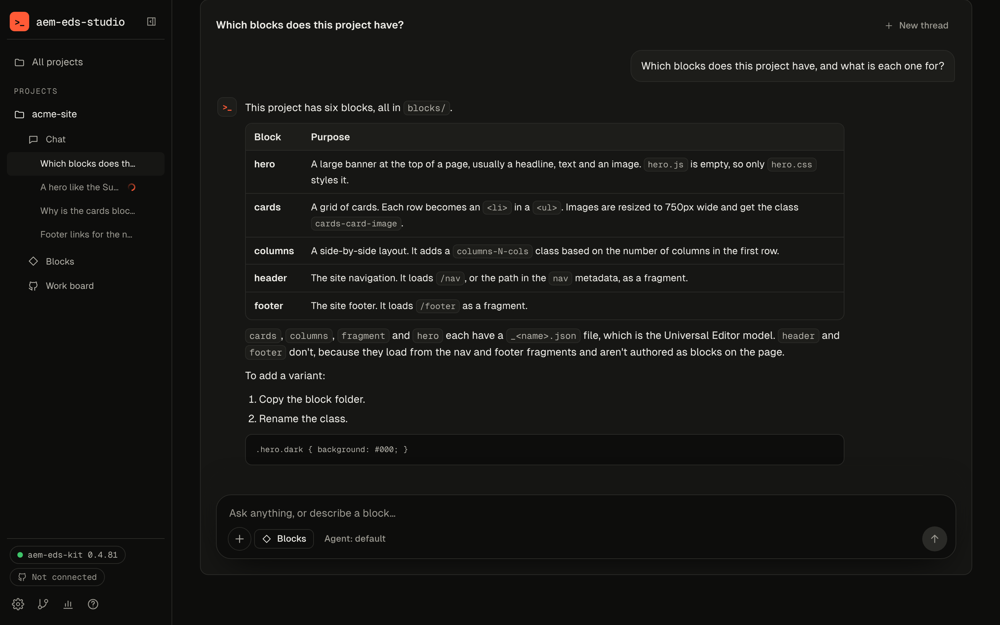
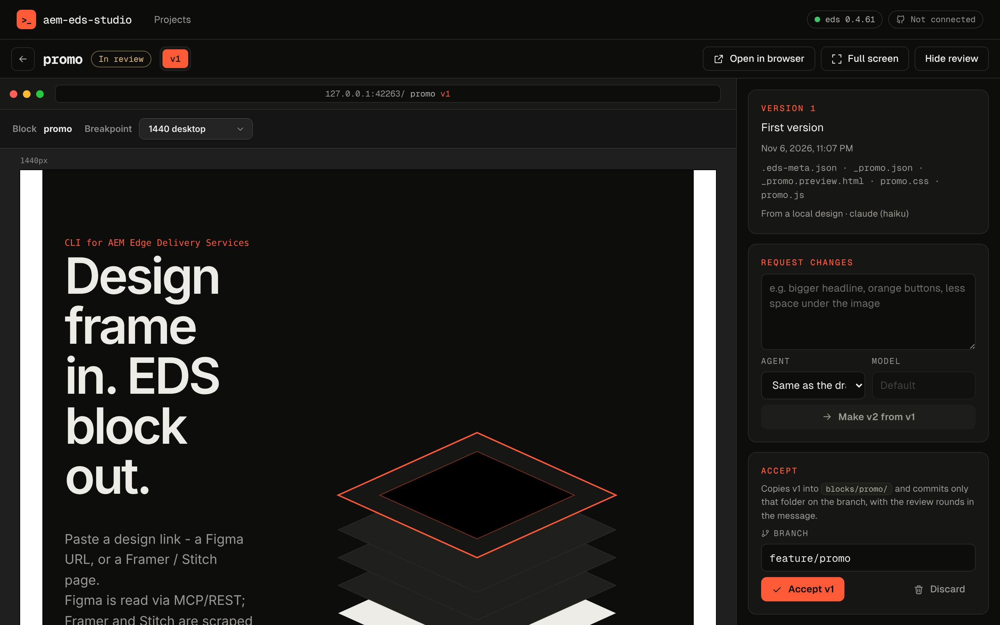
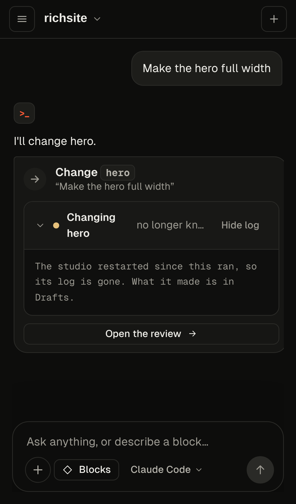

<p align="center">
  
</p>

<h1 align="center">AEM EDS Studio</h1>

<p align="center">
  Turn designs and plain words into AEM Edge Delivery blocks with your AI agent.<br>
  Anyone on the team takes a feature from idea to pull request. Developers review and merge. macOS and Windows.
</p>

<p align="center">
  <a href="https://piotrgodycki.github.io/aem-eds-kit/#studio"></a>
  <a href="https://piotrgodycki.github.io/aem-eds-kit/#studio"></a>
  <a href="https://piotrgodycki.github.io/aem-eds-kit/#studio"></a>
</p>

<p align="center">
  <a href="https://github.com/piotrgodycki/aem-eds-studio/releases"></a>
  <a href="https://github.com/piotrgodycki/aem-eds-studio/actions/workflows/desktop.yml"></a>
  <a href="https://www.npmjs.com/package/aem-eds-kit"></a>
</p>



Describe a block or paste a design link; your AI agent builds it, you review it, a developer accepts it. Engine: **[aem-eds-kit](https://github.com/piotrgodycki/aem-eds-kit)**.

## Features

- Chat with your project: ask, drop in designs, screenshots, PRs; say yes to a proposed block or change
- Blocks from Figma, a web page, a screenshot or plain words
- Review on desktop, tablet and phone (or all three), click an element to say what to change
- QA with Select: an element's size, font, colours, margin and padding as in DevTools, a screenshot with them drawn on, and Report, which opens a GitHub issue with both, or a Bug in Jira or Azure DevOps with the screenshot attached
- Jira or Azure DevOps as the project's tracker (Project settings): QA reports go there, and a draft on feature/STUDIO-12 links to STUDIO-12. The token is kept in the system keychain
- One working copy per draft: each message in the review is a change applied at once, Undo takes it back, and nothing reaches GitHub before the pull request
- Pull requests with a short summary, Before / After test URLs and screenshots; reviewers and assignee
- Ticket branches (`feature/STUDIO-1`, `bug/STUDIO-2`)
- Edit content in DA or the Universal Editor from the project and the review: the link is found from the repository (DA) or pasted (UE), and checked
- Copy a block as a table for Document Authoring (da.live), with texts the agent writes when the block has none and a line where each image goes
- Overview: blocks with what to do first (unused ones that can go, ones on many pages to test widely, ones seen but rarely clicked, ones that send no events) and each block's pages, views, click rate and last change, for estimating QA and development work. Also third parties, data layer, page metadata, events, GTM (its container ID from the sheet in the content tree, with Edit in DA)
- Performance: Core Web Vitals from the site's RUM data (the domain and key kept in the keychain, behind a closed eye), the pages to look at, what runs in each loading phase with third parties flagged, and a go-live check of the CDN against Adobe's guides
- Analytics per block: events, names, data layers
- The page event is yours: its name and every field (start from the default, GA4 or the Adobe Client Data Layer, a dot nests a field), each from metadata, the URL, a query parameter, a built-in, a fixed value or a function the agent writes, saved as a pull request and checked on the published pages
- Your own events for blocks, with their fields (an attribute, an element's text, the block's position, the link, a page event field): defined once in Overview, picked in a block's Analytics, also for clicks on one element
- Agents tab: every run numbered (AG-142), grouped, filtered, kept across restarts
- New issue on the Manager's Report: a Feature, Bug or Task from a few notes, screenshots or files, and the block it is about. The agent writes the issue, you edit it in a rich text editor or ask the agent to change it (all of it, or a sentence you select), and only Create opens it, in Jira or Azure DevOps when the project has a tracker, else on GitHub
- Roles: Manager, QA, Developer or Content author, picked once and changed in the side menu. Everyone starts on the chat, shaped for the role: its suggestions, and an agent that answers a Manager about progress and size, QA about what to test and where, and a Content author about blocks and their tables. Each role's own screen comes right after: the 30-day report, the drafts to check with the pages that have problems, or the blocks to use. The rest is under More, nothing is locked
- Page changes from the chat (DA projects): a Content author asks for a change in words, the agent proposes it, and a card shows each changed section before and after. Accept writes the page to DA and previews it, Publish puts it live. The DA token goes in Project settings, kept in the keychain
- What the studio saved: blocks accepted, first tries, versions each, time to accept, agent minutes and cost, in Overview and the agents palette
- Agents palette in the screen's corner while the studio is in the background
- Templates: order a page's sections and blocks (drag and drop, a style per section, a variant per block), set each block's starting content from its Universal Editor fields, and see the whole page live with the project's own blocks and the site's header and footer, on desktop or phone
- Every pull request the studio opens ends with What to test: the blocks it changes with the pages they are on (linked on the branch's preview), shared code that reaches every page, and authoring changes, so QA knows where to look
- Work board: GitHub pull requests and issues with the studio's own work
- From your phone: pair with a QR code (Wi-Fi or Tailscale), and the project is its chat, see [docs/remote.md](docs/remote.md)
- Logs in Settings → Logs
- Safe by default: agents stay in the project, tokens in the system keychain

<p>
  
  
</p>

## Install

Download from the [site](https://piotrgodycki.github.io/aem-eds-kit/#studio) or [Releases](https://github.com/piotrgodycki/aem-eds-studio/releases). Unsigned builds: *Open Anyway* (macOS) / *Run anyway* (Windows) on first launch. You need an agent signed in with your account and `git`; no Node.

## Development

Electron, React 19 and Hono in TypeScript; tests with Vitest, lint with Biome.

```bash
pnpm install
pnpm run desktop                                  # build and open the app
pnpm run dev:server   # + pnpm run dev:web        # API on :4600, UI with hot reload
pnpm run lint && pnpm run typecheck && pnpm test  # tests use a fake eds
```

Docs: [architecture](docs/architecture.md), [releases](docs/releases.md), [changelog](CHANGELOG.md).

## License

MIT © Piotr Godycki
