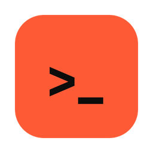
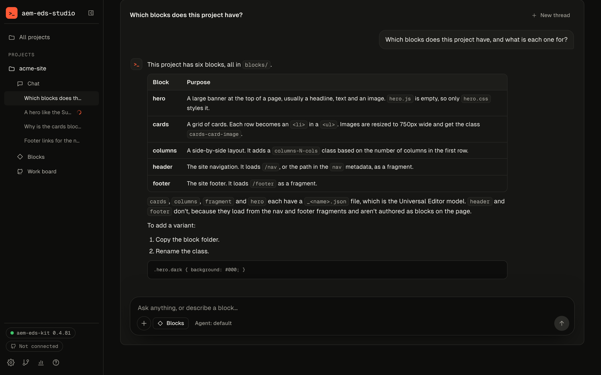
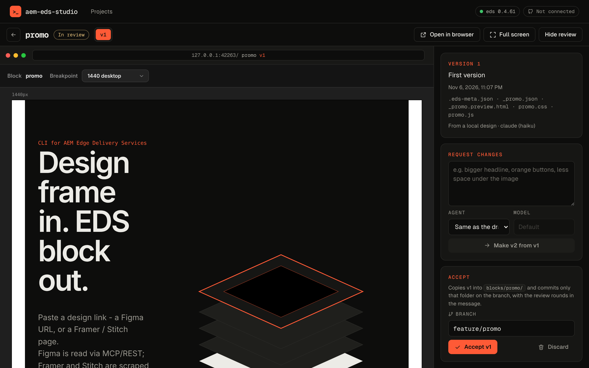
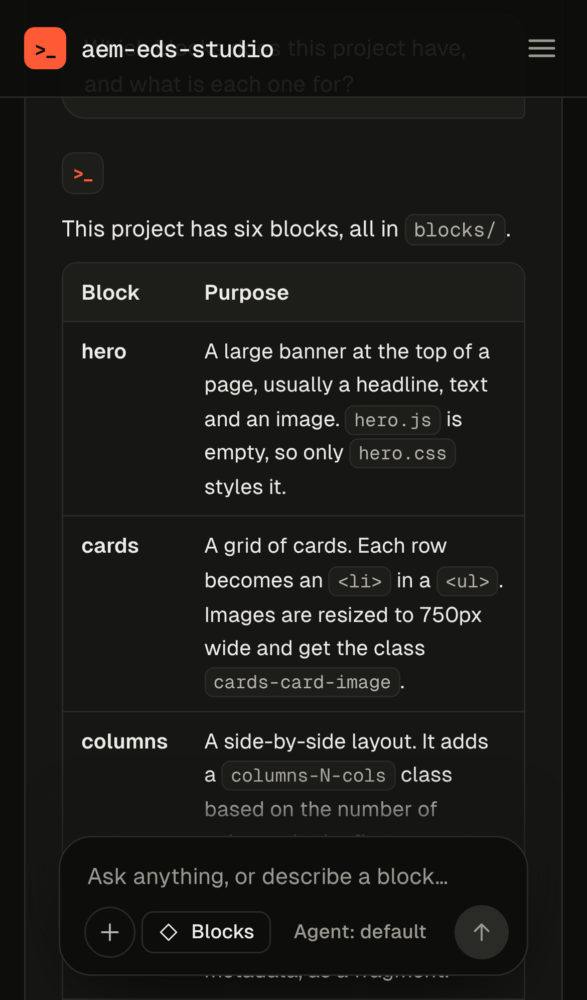

<p align="center">
  
</p>

<h1 align="center">AEM EDS Studio</h1>

<p align="center">
  Turn designs and plain words into AEM Edge Delivery blocks with your AI agent.<br>
  For the whole team; developers accept. macOS and Windows.
</p>

<p align="center">
  <a href="https://piotrgodycki.github.io/aem-eds-kit/#studio"></a>
  <a href="https://piotrgodycki.github.io/aem-eds-kit/#studio"></a>
  <a href="https://piotrgodycki.github.io/aem-eds-kit/#studio"></a>
</p>

<p align="center">
  <a href="https://github.com/piotrgodycki/aem-eds-studio/releases"></a>
  <a href="https://github.com/piotrgodycki/aem-eds-studio/actions/workflows/desktop.yml"></a>
  <a href="https://www.npmjs.com/package/aem-eds-kit"></a>
</p>



Describe a block in plain words or paste a design link. Your AI agent (Claude Code, Codex or a local model) builds it, you review it on desktop, tablet and phone, and a developer accepts it onto a branch. Nothing reaches the repository before that. The engine is **[aem-eds-kit](https://github.com/piotrgodycki/aem-eds-kit)**: the studio runs its `eds` CLI for every step.

## Features

- **Chat** is each project's first screen. Ask about the project, drop in a design, a screenshot, a pull request or another thread, and say yes when the agent proposes a block, or a change to one already in `blocks/` (no design needed). Threads run side by side. Type `/` for commands; `+` adds files.
- **Review** each draft on three devices, ask for changes in rounds; a developer (write access on GitHub) accepts it onto a branch. Each project shows whether you are a Developer or a Contributor.
- **From your phone:** pair it with a QR code (Settings → Network access), on the same Wi-Fi or anywhere through Tailscale. See [docs/remote.md](docs/remote.md).
- **Projects** from GitHub or a local folder. Each has tabs for Chat, Blocks (a new block from a design), Drafts (what waits for review) and the Work board (GitHub's pull requests and issues with the studio's own running work and drafts); its pull requests sit beside the chat.
- **Safe by default:** agents stay inside the project, tokens stay in the system keychain, and a paired phone can't change settings or accept anything.

<p>
  
  
</p>

## Install

Download from the [site](https://piotrgodycki.github.io/aem-eds-kit/#studio) or [Releases](https://github.com/piotrgodycki/aem-eds-studio/releases). Unsigned builds: *Open Anyway* (macOS) / *Run anyway* (Windows) on first launch. You need an agent signed in with your account and `git`; no Node.

## Development

Electron, React 19 and Hono in TypeScript; tests with Vitest, lint with Biome.

```bash
npm install
npm run desktop                                   # build and open the app
npm run dev:server   # + npm run dev:web          # API on :4600, UI with hot reload
npm run lint && npm run typecheck && npm test     # tests use a fake eds
```

Docs: [architecture](docs/architecture.md), [releases](docs/releases.md), [changelog](CHANGELOG.md).

## License

MIT © Piotr Godycki
