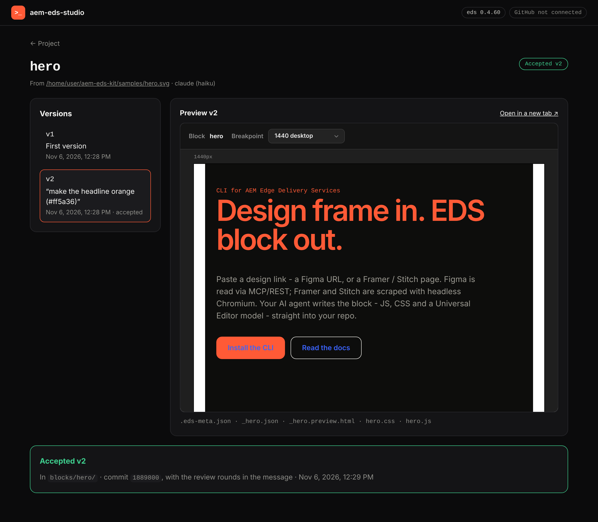

# aem-eds-studio

The app around [aem-eds-kit](https://github.com/piotrgodycki/aem-eds-kit): one place where **developers, managers and clients** turn designs into AEM Edge Delivery blocks, review them, and accept them into the project's repository.

`aem-eds-kit` (the `eds` CLI) stays the engine. The studio never re-implements generation, migration or checks; it runs `eds` as a tool and adds what a team needs around it.

## What it does

- **Projects from GitHub.** Sign in with GitHub, pick a repository (or start one from the latest EDS boilerplate), and the studio clones it into a workspace and detects the authoring model.
- **Pick the model.** A default per project, overridable per job: Claude through the API (Haiku, Sonnet, Opus), a local model (Ollama, oMLX, any OpenAI-compatible server) or, on a developer's machine, Claude Code / Cursor / Codex. Every job shows what it cost.
- **MCP servers.** Per project: AEM MCP (content, Content Fragments, assets), Figma MCP, or your own. They're handed to the agent, so blocks can be built from real AEM content.
- **Drafts, review rounds, acceptance.** Nothing reaches the repository until someone accepts it:

```text
design link (Figma / Framer / Stitch / page)
   │
   ▼
draft v1  ──►  preview link for the client / manager
   │                 │
   │      ┌──────────┴──────────┐
   │      ▼                     ▼
   │  "Change": a comment    "Accept"
   │      │                     │
   └── next round (v2, v3…)     ▼
                       commit on a branch + pull request
                       (a developer merges)
```

  A first version that's already right is accepted straight away; a rejected draft is dropped and the repository never changes.

- **Roles.**
  - **Developer:** everything: new project, design → block, AEM migration, checks, publish; can accept and commit directly.
  - **Manager:** migration report (what maps automatically, what needs manual work), quality dashboard (accessibility, visual regression, loading, security), progress; accepts or comments.
  - **Client:** paste a design link, see the block and how it compares with the design, then "Change" or "Accept".
- **Secrets stay server-side:** model API keys, Figma tokens, AEM / DA credentials live in a per-project vault, never in the repository or the client's browser.

## Run it



The studio runs on your machine and opens in the browser. It needs Node 20+; the engine (`eds` from [aem-eds-kit](https://www.npmjs.com/package/aem-eds-kit), 0.4.60 or newer) comes with it. To generate blocks you also need an agent on the machine (Claude Code, Cursor, Codex, or a local model through Ollama / oMLX).

```bash
npx aem-eds-studio              # → http://127.0.0.1:4600/
```

- **Projects:** *Add project* → **From GitHub** (your repositories; the studio clones the one you pick into `~/.aem-eds-studio/workspaces/`) or **Local folder** (any Edge Delivery project on disk).
  For GitHub, start the studio with `GITHUB_TOKEN` set or after `gh auth login`. The token stays on the server and is handed to git through the environment.
- **New block:** paste a design link (Figma, Framer, Stitch or any page) and a block name, or try the sample design. Pick the agent and model, or keep the project's default (*Project settings*). The live log shows each step the agent takes and what the round cost.
- **Review:** every version has a preview. *Request changes* sends a comment, and the agent makes the next version from the one you're looking at.
- **Accept:** *Accept vN* copies that version into `blocks/<name>/` and commits only that folder on a branch (default `feature/<name>`), with the review rounds in the commit message. The project folder is left on that branch, ready to push. *Discard draft* drops every version; the repository is not touched.

Options:
- `--port <n>`: the port to listen on (default 4600).
- `--no-open`: don't open the browser.
- `EDS_BIN=/path/to/eds.js`: use a specific `eds` instead of the bundled one.
- `AEM_EDS_STUDIO_HOME`: where projects and clones live (default `~/.aem-eds-studio`).

**Safety:**
- The server listens on 127.0.0.1 only and refuses other `Host` headers (DNS rebinding) and writes from other origins.
- Every action is an `eds` command spawned without a shell. The values that go into it (design link, block name, branch, model) are validated, and a review comment is passed after `--`, so it can never be read as an option.

## How it uses the CLI

Each job runs `eds` in its own process and reads its machine-readable output, so one client's job can't take the app down and every job can be limited in time and resources:

```text
studio                                       aem-eds-kit (npm)
  new job    ──spawn──►  eds block from-design <link> --draft --json
             ◄─────────  JSON events: progress, log, files, cost, result
  "Change"   ──spawn──►  eds draft refine hero "<comment>" --json
  "Accept"   ──spawn──►  eds draft accept hero --branch … --json
```

The CLI already has drafts (`--draft`, `eds draft list | preview | refine | accept | discard`) and the versioned `--json` event stream; the studio checks for 0.4.60 or newer at start. Still to come in aem-eds-kit: `--agent api` (Claude through the API, with model choice and cost, so no local agent is needed) and `--mcp-server` passed to the agent.

## Roadmap

1. **CLI groundwork** (in aem-eds-kit): drafts ✓, `--json` ✓, `--agent api`, `--mcp-server`.
2. **Studio, local first:** `npx aem-eds-studio` opens it in the browser.
   - Done: GitHub import, model choice, drafts with review rounds, accept onto a branch.
   - Next: a pull request after accept, MCP config, roles.
3. **Shareable reviews:** a link a client can open to review and accept.
4. **Hosted** (a business decision: where it runs, who pays for AI, sign-in, design confidentiality), and optionally a desktop wrapper of the same UI.

See [`docs/architecture.md`](docs/architecture.md).

## Development

```bash
npm install
npm run build && EDS_BIN=../aem-eds-kit/dist/bin/eds.js npm start
npm run dev:server   # the API on :4600 (tsx watch); add --port to change it
npm run dev:web      # the UI with hot reload (Vite), API calls proxied to :4600
npm run lint && npm run typecheck && npm test
```

The tests run the server against `tests/fixtures/fake-eds.mjs`, a stand-in that answers like `eds --json` does, so no agent runs in CI.
